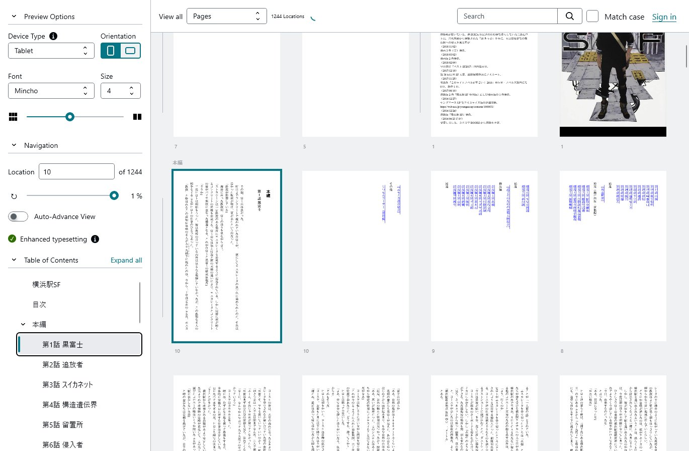

# kkym

`kkym` is a Node-based CLI command to download and convert a Kakuyomu work (novel) into an EPUB structure for the purpose of private offline reading. The generated files may then be manually fine-tuned and zipped/packed to create a single EPUB or Kindle book.

This program has been developed for my personal use, only tested on a Windows environment and an old Kindle Paperwhite with a few works of my own interests. It may not have much compatibility with other conditions.

<p align="center">
<br/>
Converted book sample, shown in Kindle Previewer 4 (横浜駅SF)
</p>

Output structure:

```
<OUTPUT-DIR>/
+- mimetype
+- META-INF/
   +- container.xml
+- OEBPS/
   +- kkym.css
   +- intro.html      -- work introduction
   +- toc.html        -- table of content
   +- <EPISODE-FILES> -- episodes (the main text)
   +- terms.html
+- content.opf
+- cover.xhtml        -- cover file
+- cover.jpg          -- cover image if any
+- nav.xhtml
+- toc.ncx
```

Where `<EPISODE-FILES>` is one or more episode files, named as `c#e##.html` or `e##.html` where # is the sequential number of the chapter and/or episode.

Conversion behaviors:

- The content text is arranged vertically, read from right to left, with an exception of `OEBPS/intro.html` which is written horizontally.
- Text justification is disabled simply because I don't like it.
- In the vertical-layout pages, numbers of 1, 3, 4 digits, alphanumerics of 1 or 2 letters, and uppercase alphabet sequences are rendered upright (CSS `text-orientation:upright`). 2-digit numbers are rendered combined upright (`text-combine-upright:all`). Longer alphanumerics are shown sideways. (More adjustments needed?)
- The cover image `cover.jpg` is taken from the work definition. If the image height is smaller than 1600px, it's automatically enlarged (using `sharp`) in order to avoid the issue that a smaller cover image may not be displayed on Kindle devices.

## Install

This program is written in TypeScript with Node.js and managed using [pnpm](https://pnpm.io/).

Dependencies:

- Node.js 24
- External modules: [Commander.js](https://github.com/tj/commander.js), [jsdom](https://github.com/jsdom/jsdom), [mustache.js](https://github.com/janl/mustache.js), [sharp](https://sharp.pixelplumbing.com/)

The release tarball contains the compiled JS code and asset files. Download the tarball and install it with:

```
pnpm install -g <FULL-PATH>\kkym-<VERSION>.tgz
```

(Or npm equivalent could be used, hopefully.)

On Windows, `pnpm` may silently fail to create "bin" files (kkym, kkym.CMD) due to path/link related problems when trying to install from a local directory or a relative tarball path. To workaround this, make sure to specify the full path to the tarball.

## Basic Usage

For available commands and options, run `kkym help` or `kkym <COMMAND> --help`.

To download a Kakuyomu work without conversion:

```
kkym download <WORK-URL> --output <DOWNLOAD-DIR>
```

Where `<WORK-URL>` is a Kakuyomu work URL or ID.<br/>
This command downloads the work page, episodes and cover image (if any). The work page is saved as `<WORK-ID>.html` and can be renamed for easier identification. The episode files and cover image should be kept in the original names.

To convert the work into an EPUB structure using the downloaded files:

```
kkym epubify <DOWNLOAD-DIR>/<WORK-ID>.html --output <OUTPUT-DIR>
```

After the output files are successfully generated, I would recommend reviewing and editing them to correct possible issues, such as missing cover image, too much extra spaces between lines, corrupt layouts and so on. Then you may want to create an EPUB file:

```
cd <OUTPUT-DIR>
zip -0X ../<EPUB-FILE> mimetype
zip -9rDXJu ../<EPUB-FILE> * -x mimetype
```

Or a Kindle KPF file:

```
kindlepreviewer4 <OUTPUT-DIR>/content.opf --convert --output <KPF-OUTPUT-DIR>
```

Or a Kindle MOBI file:

```
kindlegen -c2 <OUTPUT-DIR>/content.opf -o <MOBI-FILE>
```

Note that `kindlegen` creates the output file in the same directory as the input file.

## Terms

- This program is intended to enable offline reading of Kakuyomu works in vertical text layout. The output content can only be used for private purposes. Reproduction, redistribution, commercial use, and any other acts of copyright infringement are prohibited.
- Do not use this command in a way to put load on the source servers.

## License

Copyright (C) 2026 SLigno (Sato).

This program is free software: you can redistribute it and/or modify it under the terms of the GNU General Public License as published by the Free Software Foundation, either version 3 of the License, or (at your option) any later version.

This program is distributed in the hope that it will be useful, but WITHOUT ANY WARRANTY; without even the implied warranty of MERCHANTABILITY or FITNESS FOR A PARTICULAR PURPOSE. See the GNU General Public License for more details.

You should have received a copy of the GNU General Public License along with this program. If not, see <https://www.gnu.org/licenses/>.
